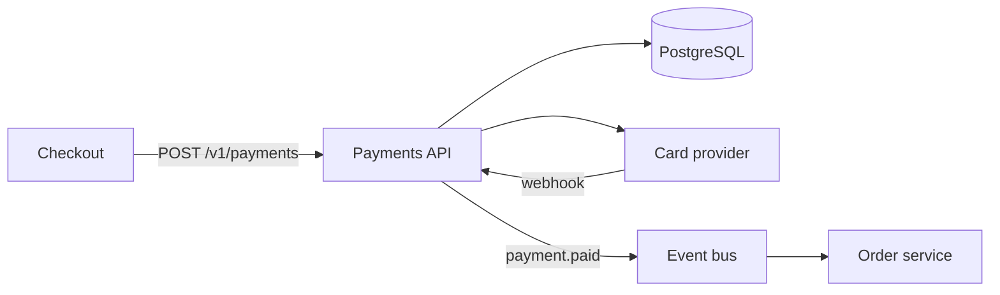

# Architecture

How the Payments Service is built today, and why.

## Context

Checkout calls the Payments Service to charge an order. The service talks to the card provider and tells the
order service the result through the event bus.

## Overview

## Components

- **API:** receives payments, stores them and calls the provider
- **Webhook handler:** receives the provider's answers and updates the payment
- **Sync job:** every 5 minutes, asks the provider about payments `pending` for too long

## Data

One table for payments and one for refunds. Card numbers never reach our database: the checkout sends a token.

## Integrations

| System        | How                | Why                 |
| ------------- | ------------------ | ------------------- |
| Card provider | HTTPS and webhooks | Charge and refund   |
| Event bus     | Publish            | Tell other services |

## Important decisions

- [ADR 0003: idempotency keys](adr.md)
- [RFC 0007: retries with a queue](rfc.md)

## Known risks

- The provider is a single point of failure; the queue mode only delays payments.
