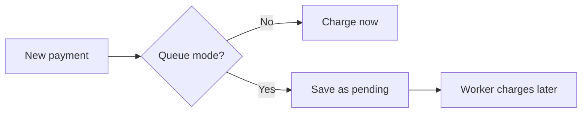

# RFC 0007: retries with a queue when the provider is down

Status: Accepted

Author: Payments team · Date: 2026-08-20

## Summary

When the card provider is down, store new payments in a queue and charge them when it comes back, instead of
failing them right away.

## Problem

During the three provider outages this year, every payment failed and customers had to start over. About 30%
did not come back.

## Proposal

A `queue mode` flag. When it is on, `POST /v1/payments` saves the payment as `pending` and answers right away;
a worker charges the queue when the provider answers again, oldest first.

## Alternatives

| Option          | Pros                        | Cons                           |
| --------------- | --------------------------- | ------------------------------ |
| Queue mode      | Customers do not start over | Orders wait; more code         |
| Second provider | No waiting                  | Contract, cost, months of work |
| Do nothing      | No work                     | Lost sales in every outage     |

## Risks and open questions

- A card can be declined hours later: the order service must handle `payment.failed` late. (Answered: it does.)
- How long to keep queued payments: 2 hours, then fail them.

## Rollout

Behind the flag, turned on by hand from the runbook. Shipped in 2.3.0.
