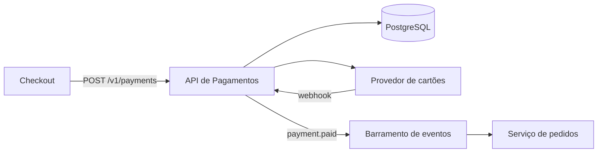

# Arquitetura

Como o Serviço de Pagamentos é construído hoje, e por quê.

## Contexto

O checkout chama o Serviço de Pagamentos para cobrar um pedido. O serviço fala com o provedor de cartões e avisa
o serviço de pedidos do resultado pelo barramento de eventos.

## Visão geral

## Componentes

- **API:** recebe os pagamentos, guarda e chama o provedor
- **Receptor de webhooks:** recebe as respostas do provedor e atualiza o pagamento
- **Job de sincronização:** a cada 5 minutos, pergunta ao provedor sobre pagamentos em `pending` há muito tempo

## Dados

Uma tabela para pagamentos e uma para estornos. Números de cartão nunca chegam ao nosso banco: o checkout manda
um token.

## Integrações

| Sistema               | Como             | Por quê                   |
|-----------------------|------------------|---------------------------|
| Provedor de cartões   | HTTPS e webhooks | Cobrar e estornar         |
| Barramento de eventos | Publicação       | Avisar os outros serviços |

## Decisões importantes

- [ADR 0003: chaves de idempotência](adr.md)
- [RFC 0007: novas tentativas com fila](rfc.md)

## Riscos conhecidos

- O provedor é um ponto único de falha; o modo fila só adia os pagamentos.
