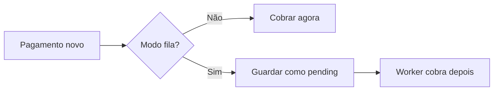

# RFC 0007: novas tentativas com fila quando o provedor cai

Status: Aceita

Autor: time de Pagamentos · Data: 2026-08-20

## Resumo

Quando o provedor de cartões está fora do ar, guardar os pagamentos novos numa fila e cobrar quando ele voltar,
em vez de falhar na hora.

## Problema

Nas três quedas do provedor este ano, todos os pagamentos falharam e os clientes tiveram de recomeçar. Uns 30%
não voltaram.

## Proposta

Uma flag `queue mode`. Ligada, o `POST /v1/payments` guarda o pagamento como `pending` e responde na hora; um
worker cobra a fila quando o provedor volta a responder, do mais antigo para o mais novo.

## Alternativas

| Opção            | Prós                   | Contras                            |
| ---------------- | ---------------------- | ---------------------------------- |
| Modo fila        | Clientes não recomeçam | Pedidos esperam; mais código       |
| Segundo provedor | Sem espera             | Contrato, custo, meses de trabalho |
| Não fazer nada   | Nenhum trabalho        | Vendas perdidas a cada queda       |

## Riscos e perguntas em aberto

- Um cartão pode ser recusado horas depois: o serviço de pedidos precisa tratar `payment.failed` atrasado.
  (Respondido: ele trata.)
- Por quanto tempo guardar os pagamentos na fila: 2 horas, depois falham.

## Implantação

Atrás da flag, ligada à mão pelo runbook. Saiu na 2.3.0.
